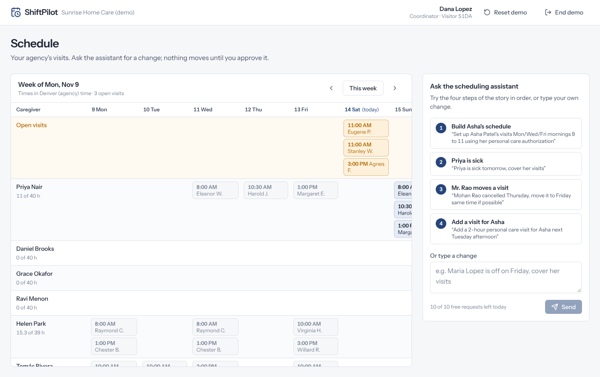
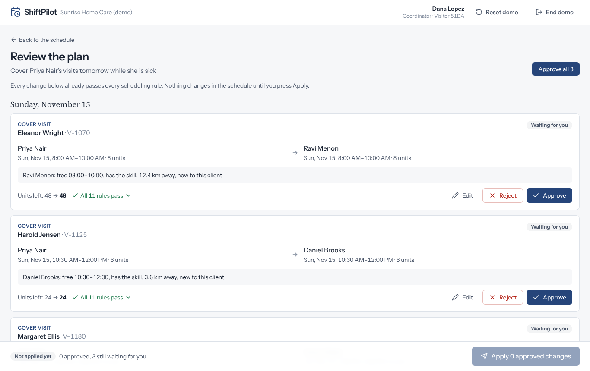
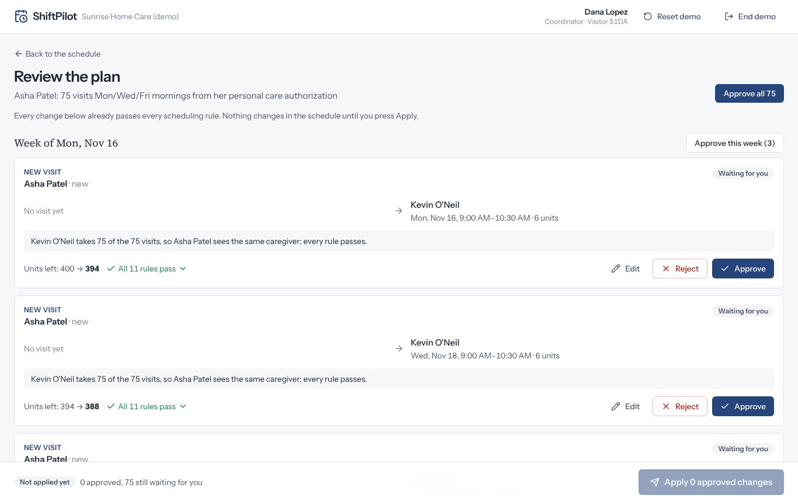
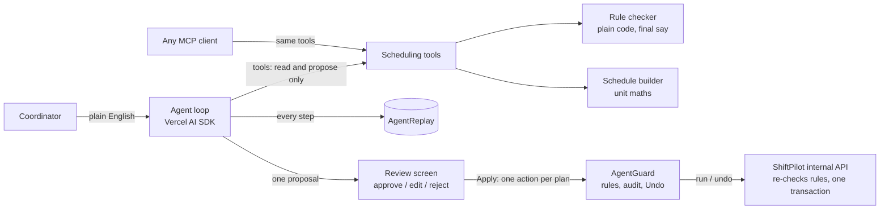

# ShiftPilot

**An AI scheduling assistant for home care coordinators.**

A coordinator types a change in plain English: *"Priya is sick tomorrow, cover her visits."* An AI agent finds the affected visits, looks for caregivers who are free, qualified and nearby, keeps every visit inside the client's Medicaid authorization, and proposes an updated schedule with a reason for each change. **The coordinator approves, edits or rejects each change. Nothing moves until they do.**

> MERN + TypeScript. The AI plans; plain code checks every rule. Approved plans are applied through [AgentGuard](https://github.com/deepak-r-fullstack/agentguard) (rules, audit trail, Undo) and every run is recorded in [AgentReplay](https://github.com/deepak-r-fullstack/agent_replay).

**Live demo:** [shiftpilot-lbsp.onrender.com](https://shiftpilot-lbsp.onrender.com) (free hosting: the first visit can take about a minute to wake up). Every visitor gets a private copy of a made-up agency.



---

## The 60-second demo

Press the four story buttons in order:

| Step | The coordinator says | What the agent does |
| --- | --- | --- |
| 1 | "Set up Asha Patel's visits Mon/Wed/Fri mornings 9 to 11 using her personal care authorization" | Spreads her 400 authorized units evenly over 6 months (never above 20 a week), gives every visit the same caregiver where the rules allow, and proposes ~75 visits, grouped by week |
| 2 | "Priya is sick tomorrow, cover her visits" | Finds Priya's 3 visits and gives each one to someone free, qualified and close by |
| 3 | "Mohan Rao cancelled Thursday, move it to Friday same time if possible" | Moves the visit, keeping his caregiver if they are free on Friday |
| 4 | "Add a 2-hour personal care visit for Asha next Tuesday afternoon" | Checks her units, picks a caregiver, proposes the new visit |

Then review the plan, press **Apply**, and follow the link to **Undo in AgentGuard**.

| Review a plan | A whole schedule from one sentence |
| --- | --- |
|  |  |

## Why this exists

I designed and owned a production caregiver scheduling module for 150–200 users at a US home care (HCBS/EVV) platform. Coordinators spend hours on phone calls and spreadsheets when one caregiver calls in sick, and every change has to stay inside each client's authorization: the approved service, the start and end dates, and a fixed number of units (one unit = 15 minutes of personal care).

That makes it a good test of **agentic AI that is safe to use**: the work needs planning across several tools, but a wrong answer (a double-booking, an unauthorized visit) is a real problem. So the AI plans, the code decides, and a person approves.

## How it works



1. **The agent** (a small, cheap tool-calling model) reads the request and calls tools: `find_visits`, `get_authorization`, `find_candidates`, `check_change`, `build_schedule`, `submit_proposal`, `ask_coordinator`. It streams each step to the screen. At most 15 steps and 60 seconds.
2. **No tool can change a visit.** The agent can only read and propose. `submit_proposal` checks every change against every rule *together* (so two changes in one plan can never clash with each other) and saves nothing if any rule fails; the agent gets the reasons and fixes the plan.
3. **The coordinator reviews** each change: before → after, a one-line reason, units left (40 → 32), and the rule checks. *Edit* offers only caregivers who pass every rule, and checks again before saving.
4. **Apply** sends the approved plan to AgentGuard as **one** action, `schedule.applyPlan`. AgentGuard's rules decide (plans that change more than 10 existing visits wait for a manager, who cannot be the coordinator), it records the decision in its hash-chained audit log, and it calls ShiftPilot back to run the plan. ShiftPilot re-checks every rule and writes all visits in **one database transaction**, refusing if any visit changed in the meantime.
5. **Undo** happens in AgentGuard, which calls ShiftPilot to put every visit back, only if nothing changed since and every rule still passes. (Without AgentGuard, or if AgentGuard lost track of a plan, Undo is offered in ShiftPilot itself.)

## The rules (checked by code, never by the AI)

| Rule | Example message when it fails |
| --- | --- |
| Visit is whole units | "A visit must be whole 15-minute units; 50 minutes is not." |
| Service is authorized | "Service HM-15 is not on this client's authorization." |
| Inside the authorization dates | "The authorization only covers 2026-11-15 to 2027-05-08." |
| Enough units left | "Only 4 units left on this authorization; this visit needs 8." |
| Per-visit and per-week unit limits | "At most 20 units a week; this week already has 16, and this visit needs 8." |
| Caregiver is working then | "Maria Lopez is off at that time." |
| Caregiver has the skill | "Ben Carter does not have the personal_care skill." |
| No double-booking (caregiver or client) | "Daniel Brooks already has a visit at Sun 15 Nov, 8:00." |
| Caregiver weekly hours limit | "Grace Okafor would work 42 hours this week; the limit is 40." |
| 15 minutes travel time between clients | "Ravi Menon needs 15 minutes to travel from the visit at Sun 15 Nov, 10:00." |

All days, weeks and times are Denver wall-clock time (the agency's zone), so a 9:00–11:00 visit is 8 units even on the day the clocks change.

## Key decisions

| Decision | Choice | Why |
| --- | --- | --- |
| Who decides whether a change is allowed | `ruleChecker.ts`, pure functions, 24 unit tests | The AI cannot "forget" a rule or be talked out of one. The same code runs in the tools, on save, on edit and at apply. |
| Agent framework | Own loop on the Vercel AI SDK (not LangGraph) | Simple to debug and explain, switch models with one setting. Pause-for-approval already lives in AgentGuard, so LangGraph's version would be a second copy. |
| What the AI may do | Read and propose only | Applying needs a person's approval and goes through AgentGuard. |
| Choosing caregivers | Code ranks those who pass every rule (knows the client > nearby > spare hours); the AI picks from that list | The AI can never invent a caregiver. |
| Building a schedule | Plain code spreads the units; continuity first (the caregiver who can take most visits gets them) | Exact unit maths; clients see the same face. |
| Apply | One AgentGuard action per plan, one MongoDB transaction that first locks the visitor's agency and re-checks every rule inside it | One Undo puts the whole plan back; never half-applied; two plans applied at the same moment cannot both double-book. |
| Undo | Re-checks the rules for every visit it brings back | Undoing an old plan can never double-book a slot a newer plan used. |
| Who is right about the visits | ShiftPilot's own record | If AgentGuard gives up waiting on a slow run that did happen, the plan still shows as applied, and Undo is offered in ShiftPilot. |
| Concurrency | Visit `version` checks, atomic draft → applying switch, idempotency keys | Two clicks or two tabs apply once; a plan never overwrites newer work. |
| Low-risk changes | Code marks a ≤ 15-minute move with the same caregiver as auto-approved | Small fixes need no click, and are still shown and undoable. |
| Public demo safety | Private sandbox per visitor (24 h), 10 typed requests per visitor per day, a hard daily AI spend cap (counted step by step, so a failed run counts too; a closed tab stops the run) | Strangers cannot see each other's data or run up a bill. When the cap is reached, the story buttons switch to a clearly labelled scripted planner that makes the same real tool calls, so review, Apply and Undo still work. |
| Time | Luxon, `America/Denver` everywhere | Days, weeks and availability are what the coordinator sees on the clock. |

## Quality: tests and evals

```bash
npm test          # 95 tests: rules, unit maths, candidates, seed, proposals, agent (scripted model), apply/undo, MCP, AgentReplay
npm run evals     # 30 fixed scenarios against the real model, checked by code
npm run check:browser   # the whole journey in a real browser, desktop and phone
```

- **Unit tests** cover every rule (pass and fail), daylight-saving days, week boundaries, the last unit, and the schedule builder's even spread, leftovers and limits.
- **API tests** (Supertest + an in-memory MongoDB replica set) cover: a plan with a broken rule saves nothing; two changes in one plan that clash; edits re-checked; sandboxes kept apart; **two simultaneous Apply clicks send one action**; **a plan refused, with nothing written, when a visit changed after it was made**; undo refused over newer work; AgentGuard unreachable (the coordinator can retry); AgentReplay down (nothing breaks).
- **Agent tests** use a scripted model: it covers Priya's visits, asks *"which Maria?"* instead of guessing, saves nothing when the AI fails, and gets refused changes back so it can fix the plan.
- **Evals** (`server/evals/`): 30 requests on the same seeded agency, 8 sick calls, 6 moves and cancels, 6 new visits (including one with only 4 units left, which must be refused), 6 schedules from an authorization, and 4 ambiguous or off-topic requests. Each has checks such as "every one of Priya's visits is covered", "no rule broken", "stays within the authorization's units", "asked which Maria". Results go to `server/evals/results/<date>.md`; the run fails below 90%.

## Works with AgentGuard and AgentReplay

ShiftPilot is the third project in a set:

- **[AgentGuard](https://github.com/deepak-r-fullstack/agentguard)** is the safety layer between AI agents and company systems. ShiftPilot's plans are applied through it, in its "Sunrise Home Care (demo)" company: the coordinator's link **Undo in AgentGuard** opens that exact action.
- **[AgentReplay](https://github.com/deepak-r-fullstack/agent_replay)** records every agent run (each AI call and each tool call), using my npm package [`@sritarak/agentreplay`](https://www.npmjs.com/package/@sritarak/agentreplay). The apply step links to its AgentGuard action, so a run can be followed from request to approval to undo.

Both are optional: without their settings ShiftPilot applies plans directly and records nothing.

| Where | Setting | Value |
| --- | --- | --- |
| ShiftPilot | `AGENTGUARD_URL` | AgentGuard's address |
| ShiftPilot | `AGENTGUARD_PUBLIC_URL` | AgentGuard's public address, for the links people click |
| Both | `SHIFTPILOT_AGENT_KEY` | the same `agk_` key (secret): ShiftPilot uses it, AgentGuard gives it to its ShiftPilot agent |
| Both | `SHIFTPILOT_INTERNAL_SECRET` | the same secret: AgentGuard sends it when it calls ShiftPilot to run or undo a plan |
| AgentGuard | `SHIFTPILOT_URL` | ShiftPilot's address |
| ShiftPilot | `AGENTREPLAY_API_KEY` | an AgentReplay SDK key (`ar_…`) |

## Use the tools from Claude (MCP)

The agent's read-and-propose tools are also an MCP server, so Claude Desktop, Claude Code or any MCP client can plan changes in your demo agency. Copy your session token from the browser's storage (`shiftpilot-session`), then:

```bash
claude mcp add --transport http shiftpilot https://shiftpilot-lbsp.onrender.com/api/mcp \
  --header "Authorization: Bearer <your session token>"
```

Ask *"Priya is sick tomorrow, cover her visits"*: the plan appears in ShiftPilot for review. MCP cannot apply anything.

## Run it on your Mac

You need **Node.js 20+** and a **MongoDB replica set** (applying a plan uses a transaction). Either a free [MongoDB Atlas](https://www.mongodb.com/cloud/atlas) cluster, or local MongoDB started as a one-member replica set:

```bash
brew tap mongodb/brew && brew install mongodb-community
mongod --replSet rs0 --dbpath ~/data/shiftpilot --port 27017 &
mongosh --eval 'rs.initiate()'
```

```bash
npm install
cp server/env/local.env.example server/env/local.env   # set MONGO_URI=mongodb://127.0.0.1:27017/shiftpilot?replicaSet=rs0

# No AI key yet? A scripted model plays the four story buttons with real tool calls:
FAKE_AI=stories npm run dev

# With a real model, set in server/env/local.env:
#   LLM_PROVIDER=anthropic (or openai)   LLM_API_KEY=...   LLM_MODEL= (empty for the default)
npm run dev
```

Open http://localhost:5174 and press **Start the demo**. Without a key (or once the daily budget is used up) the four story buttons still work: a scripted planner makes the same real tool calls, and the screen says so. Typed requests need live AI.

## Deploy (free)

1. **Database:** a free **M0** cluster on [MongoDB Atlas](https://www.mongodb.com/cloud/atlas) (Atlas clusters are replica sets). Add `/shiftpilot` before the `?` in the connection string.
2. **App:** on [Render](https://render.com), **New > Blueprint**, pick this repository. `render.yaml` sets everything up; paste the Atlas string into `MONGO_URI`.
3. Add the AI key and the AgentGuard and AgentReplay settings above as secrets when you are ready.

## Project layout

```
shiftpilot/
  server/                         Express + TypeScript + Mongoose
    src/
      api/routes.ts               every endpoint and who may call it
      services/
        scheduling/               ruleChecker (final say), scheduleBuilder, candidateFinder, changeChecker
        agent/                    agent loop, tools, prompt, model choice, scripted story planner
        proposals/                proposals, review, apply and undo (one transaction)
        integrations/             AgentGuard client, AgentReplay recording
        demo/                     seeded fake agency, visitor sandboxes, limits, cost cap
        mcp/                      the same tools over MCP
    evals/                        30 scenarios, code checks, score report
    tests/                        Jest + Supertest + in-memory MongoDB replica set
  client/                         React 18 + Vite + Tailwind + React Query + Zustand
    src/screens/                  welcome, schedule (week grid + assistant), review (approve, edit, apply)
  checks/journey.mjs              the demo journey in a real browser, desktop and phone
```

## Data

Everything is made up: the agency, every caregiver and client name, the towns, the addresses and the service codes (`PC-15`, `HM-15`, `RC-60`). The rules are modelled on public Colorado home care authorization and EVV practice. No employer code or data is used.

Built by **Deepak R**. MIT licence.
